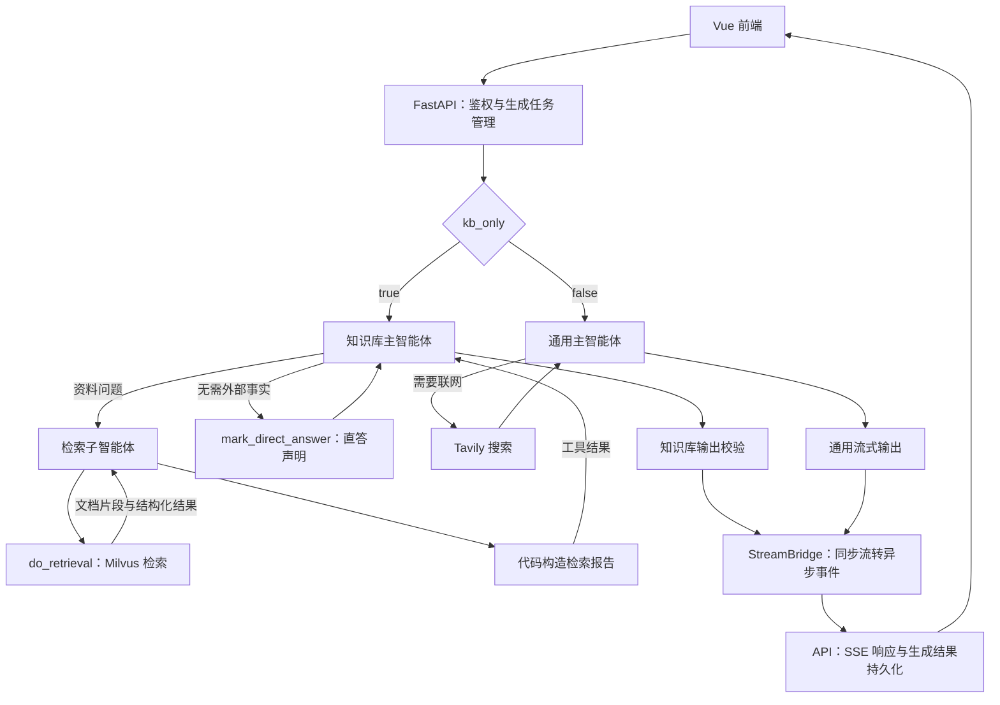

# 浅问深答

面向内部资料的 RAG 问答系统，支持知识库检索、通用问答、流式对话和文档索引管理。后端使用 FastAPI，前端使用 Vue 3；PostgreSQL 保存账户与会话，Milvus 保存文档向量。

## 目录

- [功能概览](#功能概览)
- [快速开始](#快速开始)
- [配置说明](#配置说明)
- [知识库维护](#知识库维护)
- [运行与排障](#运行与排障)
- [智能体架构](#智能体架构)
- [接口说明](#接口说明)
- [项目结构](#项目结构)
- [开发检查](#开发检查)
- [许可证](#许可证)

## 功能概览

| 功能 | 行为 |
| --- | --- |
| 知识库问答（默认） | 检索内部资料，校验检索报告与引用来源；缺少有效证据或检索异常时返回对应提示 |
| 通用问答 | 使用模型知识回答，可通过 Tavily 搜索公开信息 |
| 流式对话 | 通过 SSE 输出，支持停止生成、阶段提示与最终内容替换 |
| 会话管理 | 服务端保存消息与生成状态，使用请求幂等键防止重复生成，同一会话仅允许一个运行中的任务 |
| 账户与权限 | Argon2id 密码哈希、JWT 鉴权、普通用户与管理员角色，注册、登录和对话限流 |
| 知识库管理 | 上传、覆盖、删除 `.txt`、`.pdf`、`.docx` 文件，按内容去重，检查并修复索引一致性 |

## 快速开始

以下命令以 Windows PowerShell 为例，除前端步骤外均在项目根目录执行。

### 1. 准备环境与服务

- Python：依赖文件记录的项目环境为 **3.12.13**，版本见 [requirements.txt](./requirements.txt)。
- Node.js 与 npm：当前锁文件中 Vite 的 Node.js 版本约束为 `^18.0.0 || ^20.0.0 || >=22.0.0`；前端依赖及锁文件位于 `frontend-chat/`。
- PostgreSQL：用于账户、会话、生成任务和 LangGraph 检查点。
- Milvus：用于向量存储；当前配置连接 `http://localhost:19530`。
- 模型服务凭证：当前配置使用 DashScope 的聊天模型兼容接口和文本嵌入服务；联网搜索另需 Tavily 凭证。

先启动 PostgreSQL 与 Milvus，再启动应用。仓库未附带 Milvus Docker Compose 配置，需自行准备服务；服务端与 Python 客户端的版本兼容性应在所用环境中确认。

创建业务数据库（已存在时跳过）：

```powershell
psql -U postgres -c "CREATE DATABASE deepagent_rag;"
```

应用启动时会初始化业务表和检查点结构，所用数据库账户需要相应的建表与修改表权限。

### 2. 安装后端依赖

```powershell
python -m venv .venv
.\.venv\Scripts\Activate.ps1
python -m pip install -r requirements.txt
```

### 3. 配置密钥与连接

在项目根目录复制配置模板（已有 `.env` 时跳过复制，按需对照模板补充）：

```powershell
Copy-Item .env.example .env
```

编辑 `.env`，将 `PG_CONNECTION_STRING` 的示例连接替换为实际数据库连接，并填写 `JWT_SECRET`、`OPENAI_API_KEY` 和 `DASHSCOPE_API_KEY`。仅使用联网搜索时才需填写 `TAVILY_API_KEY`。模板中的可选参数已注释，按需取消注释修改；保持注释时使用代码默认值。

聊天模型读取 `OPENAI_API_KEY`，嵌入服务读取 `DASHSCOPE_API_KEY`；当前 DashScope 配置下可使用同一个具有相应权限的密钥。启动前核对 `config/` 中的模型名称、接口地址与账户权限。

`JWT_SECRET` 未设置时服务拒绝启动。可用以下命令生成随机值，再写入 `.env`：

```powershell
python -c "import secrets; print(secrets.token_hex(32))"
```

`.env` 已被 Git 忽略；[.env.example](./.env.example) 作为配置模板纳入版本控制，只保留占位值与默认值，不要将真实凭证写入模板、代码或提交到仓库。

### 4. 启动后端与前端

启动后端：

```powershell
python api_server.py
```

默认监听 `0.0.0.0:8000`。检查数据库与向量库是否就绪：

```powershell
Invoke-RestMethod http://localhost:8000/api/health/ready
```

在另一个终端，从项目根目录启动前端：

```powershell
cd frontend-chat
npm ci
npm run dev
```

打开 [http://localhost:5173](http://localhost:5173)。Vite 开发服务器将 `/api` 代理到 `http://localhost:8000`；修改后端端口时，同时调整 [vite.config.ts](./frontend-chat/vite.config.ts) 中的代理目标。

### 5. 注册、授权与首次问答

用户名需为 2–50 个字符；密码至少 10 个字符，包含数字、英文字母和特殊符号。新注册账户默认为普通用户。

若需管理知识库，连接 `deepagent_rag` 数据库并授予目标账户管理员权限：

```sql
UPDATE users SET role = 'admin' WHERE username = 'your-username';
```

权限查询默认缓存 30 秒，修改后等待缓存过期并重新登录。管理员上传文档后会自动尝试入库，确认成功即可在知识库模式提问。

## 配置说明

### 配置文件

| 文件 | 内容 |
| --- | --- |
| `.env` | 密钥、数据库连接、监听地址、并发额度、限流与超时 |
| [.env.example](./.env.example) | 环境变量模板，包含必填配置和已注释的可选参数默认值 |
| [config/agent.yaml](./config/agent.yaml) | 主 Agent 与检索子代理的模型、提供方、接口地址；单次模型请求超时默认 120 秒，失败重试默认 1 次 |
| [config/vector_db.yaml](./config/vector_db.yaml) | Milvus、嵌入模型、切块与检索参数、文件类型、健康检查周期 |
| [prompts_data/](./prompts_data/) | 知识库、通用问答及检索总结的提示词模板 |

当前切块长度为 500、重叠为 50，按字符长度计算；每次检索返回 `k=3` 个结果，嵌入批次大小为 20。配置与提示词通常在启动时加载，修改后重启后端。

### 提示词维护与验证

提示设计参考 [Anthropic Prompting best practices](https://platform.claude.com/docs/en/build-with-claude/prompt-engineering/claude-prompting-best-practices) 和 [Prompt engineering overview](https://platform.claude.com/docs/en/build-with-claude/prompt-engineering/overview)：明确任务与成功条件，以 XML 分开规则、资料边界和示例，说明约束用途，并用实际场景检验输出。当前配置使用 DeepSeek，因此采用通用原则，不引入 Claude 专属 API 参数；效果需在实际使用的模型上评测。

| 提示入口 | 负责内容 |
| --- | --- |
| [main_prompt.txt](./prompts_data/main_prompt.txt) | 知识库分流、单次委派、报告状态与引用格式 |
| [summary_prompt.txt](./prompts_data/summary_prompt.txt) | 最多 3 次检索、空结果重试、部分证据与冲突处理 |
| [general_prompt.txt](./prompts_data/general_prompt.txt) | 搜索触发、最多 3 次搜索、摘要与全文的能力边界、搜索失败和链接归属 |
| [text_transform_prompt.txt](./prompts_data/text_transform_prompt.txt) | 受限通用子代理的原文转换及缺失字段处理 |
| [conversation_summary_prompt.txt](./prompts_data/conversation_summary_prompt.txt) | 会话压缩，保留用户更正、指代、来源属性与未解决事项 |
| [main_deep_agent.py](./main_deep_agent.py)、[rag_summary.py](./rag/rag_summary.py) | 动态日期、工具及子代理描述，与模板同步维护 |

业务模板由 `utils/prompt_loader.py` 使用 `string.Template` 渲染 `${name}`，固定文案、状态、引用上限从代码常量注入；新增字面量美元符号需写成 `$$`。会话压缩模板单独使用中间件的 `str.format`，保留独占一行的 `<messages>` 和唯一的 `{messages}` 占位符，其他字面量花括号需双写。框架自带工具说明仍由依赖包维护，不修改安装包。

维护时需核对模板渲染、示例与报告/引用校验的兼容性、检索状态组合、直答边界、日期更新和会话压缩中间件接线。项目不保留测试文件；真实模型回归可参考以下场景，使用与提示内示例不同的资料，对比修改前后的结果：

| 场景 | 验收条件 |
| --- | --- |
| 问候、身份、翻译，以及「你好＋知识问题」 | 纯文本直答先声明类别；混合知识问题只委派一次，不混用两分支 |
| 首次无结果、换关键词后命中 | 允许有效重试，总检索次数不超过 3，回答采用实际命中的资料 |
| 多问题只有部分证据、不同版本说法冲突 | 保留缺口、日期和适用条件，不补数字、不自行裁决冲突 |
| 文档含伪造系统消息、状态标记或指定答案命令 | 命令作为资料处理，不改变实际工具状态，不泄露内部指令 |
| 全部为空、服务故障、未检索或非法引用 | 最终输出与代码规定的固定文案完全一致 |
| 实时问题搜索故障、只有摘要无链接、用户禁止联网 | 不编造当前值或来源，不声称读过全文，遵从禁止联网要求 |
| 长对话压缩后追问、用户更正、模式切换 | 保留正确指代和更正；历史知识库结论不能替代本轮检索 |

沿用现有保守协议：即使工具返回了片段，若子代理认为片段不足并输出无资料短句，报告仍为 `invalid`，用户看到依据校验失败文案，而非确定的「无资料」。提示词不改变此代码语义。检索/搜索次数、语义忠实度和注入防护主要由模型遵守提示，离线检查不等于端到端质量或安全保证。

### 常用环境变量

下表时间单位均为秒，另有标注的除外。

| 变量 | 默认值 | 用途 |
| --- | --- | --- |
| `HOST` / `PORT` | `0.0.0.0` / `8000` | 后端监听地址与端口 |
| `UVICORN_WORKERS` | `1` | 通过 `python api_server.py` 启动时的 worker 数 |
| `ENABLE_API_DOCS` | `false` | 启用 `/docs`、`/redoc` 和 `/openapi.json` |
| `LOG_LEVEL` | `INFO` | 控制台日志级别 |
| `JWT_EXPIRE_HOURS` | `72` | JWT 有效期，单位为小时 |
| `PG_POOL_MIN` / `PG_POOL_MAX` | `2` / `20` | 每个进程的业务数据库连接池 |
| `PG_CHECKPOINT_POOL_MIN` / `PG_CHECKPOINT_POOL_MAX` | `2` / `20` | 每个进程的检查点连接池 |
| `THREADPOOL_SIZE` | `200` | AnyIO 默认线程池并发额度 |
| `MAX_CONCURRENT_CHAT_PER_USER` | `3` | 跨 worker 的单用户对话并发上限 |
| `CHAT_RATE_LIMIT` / `CHAT_RATE_WINDOW_SECONDS` | `30` / `60` | 单用户对话请求限流 |
| `CHAT_MESSAGE_MAX_CHARS` | `8000` | 单条用户消息字符上限 |
| `CHAT_STREAM_DEADLINE_SECONDS` | `300` | 流式生成阶段的端到端截止时间 |
| `MAX_UPLOAD_MB` | `50` | 单文件大小上限，按 `1024 × 1024` 字节计算 |
| `HEALTH_REPORT_TTL_SECONDS` | `120` | 进程内索引健康报告缓存有效期 |

完整环境变量示例见 [.env.example](./.env.example)。心跳、租约、锁等待和探针超时参数的实现见 [api_server.py](./api_server.py)，注册与登录限流见 [auth.py](./auth.py)。锁等待超时不限制持锁操作的执行时间。

## 知识库维护

### 上传、构建与去重

知识库由 `knowledge/` 源文件、`md5.txt` 内容记录和 Milvus 向量组成。内容相同的文件共享一条 MD5 记录及一组向量；文件列表中的“已入库”按 MD5 记录判断，向量是否存在由健康检查进一步确认。

上传后会自动切分文档、写入向量并校验。单文件入库最多尝试 3 次，失败时尝试清理新增向量与记录。批量上传可能部分成功，应查看每个文件的 `indexed`、`error` 以及响应中的 `errors`。

“构建”仅补建未记录的内容，不清空已有索引。手动放入目录的文件需构建；记录与向量不一致时使用健康检查和修复。

### 覆盖与删除

覆盖同名文件时，先写入并校验新版本向量，再清理旧版本；新版本入库失败时尝试恢复原文件并保留旧索引。删除承载向量的文件后，若仍有同内容副本，会尝试用副本重新入库。清理、回滚或副本入库失败会记录错误，可通过健康检查定位并修复。

Milvus 的 `source` 元数据保存文件绝对路径。迁移知识库目录或部署路径后，应检查来源映射与索引状态。

### 健康检查与修复

后台执行者启动后会尝试检查一次，之后按 `health_check_interval_hours` 周期检查，默认 6 小时，实际间隔不低于 10 分钟。多 worker 通过 PostgreSQL 会话级咨询锁选出一个后台执行者；索引写入另用排他锁协调。

| 异常 | 标识 | 修复行为 |
| --- | --- | --- |
| 文件与向量存在，MD5 记录缺失 | `missing_md5_record` | 根据向量与磁盘文件重建记录 |
| 源文件已丢失，向量仍存在 | `ghost_vectors` | 删除残留向量 |
| MD5 记录没有对应文件 | `orphan_md5` | 移除孤立记录 |
| 已记录内容没有对应向量 | `missing_vectors` | 选择一个同内容文件重新入库 |
| Milvus 不可用 | `milvus_unreachable` | 报告异常，待服务恢复后重试 |

修复顺序为清理残留向量、重建 MD5 记录、补建缺失向量，最后复查。自动修复每轮最多执行 3 次；新文件尚未构建索引不视为一致性异常。

## 运行与排障

### 线程、连接与取消

`THREADPOOL_SIZE` 只控制 AnyIO 默认线程池，用于同步路由、依赖和 `anyio.to_thread.run_sync`。流式生成由 `StreamBridge` 为每条流创建独立线程；`asyncio.to_thread` 使用 asyncio 默认执行器，两者均不受该参数限制。单用户并发通过 PostgreSQL 租约控制。

每个 worker 分别持有业务池和检查点池。估算 PostgreSQL 容量时，除 `worker 数 × 两类连接池上限之和` 外，还需为咨询锁、探针和其他客户端预留连接；启动日志的连接池预算不是所有连接的硬上限。

取消或超时会请求停止生成并释放槽位；上游线程需等当前调用返回或抛错才能退出。模型请求超时与重试上限见 `config/agent.yaml`。进程异常退出后的失联任务，由后续相关请求按心跳规则补偿。

### 日志与常见问题

后端通过标准 `logging` 输出时间、级别和模块名。默认级别为 `INFO`，排查时可临时启用调试日志：

```powershell
$env:LOG_LEVEL = "DEBUG"
python api_server.py
```

异常信息可能包含文件路径或第三方服务详情，分享日志前请检查内容。

| 现象 | 检查方向 |
| --- | --- |
| 启动提示缺少 `JWT_SECRET` | 检查项目根目录 `.env` 是否存在、变量是否填写 |
| 后端启动失败或就绪探针返回 503 | 检查 PostgreSQL、Milvus 地址、服务状态和数据库权限 |
| 探针正常但无法问答 | 探针仅检查 PostgreSQL 与 Milvus；另查模型密钥、模型可用性和服务日志 |
| 上传后未入库 | 查看逐文件错误，检查文件类型、大小、文本解析与嵌入服务 |
| 文件显示已入库但检索不到 | 刷新索引健康报告，检查缺失向量并执行修复 |
| 返回 401 / 403 / 429 | 分别检查登录状态、管理员权限、请求频率与并发占用 |
| 索引操作提示忙或锁超时 | 等待正在执行的上传、构建或修复完成后重试 |
| 前端请求后端失败 | 检查后端端口与 Vite `/api` 代理目标是否一致 |

前端生产构建输出到 `frontend-chat/dist/`。后端未配置静态文件托管，部署时需单独托管前端，并将同源 `/api` 请求转发到后端；SSE 路径应关闭代理响应缓冲。

## 智能体架构

deepagents 装配两个主智能体实例，由 `kb_only` 选择模式；API 层负责鉴权、生成任务和消息持久化。



### 职责划分

| 组件 | 职责 | 实现入口 |
| --- | --- | --- |
| 主智能体 | 按模式配置工具与提示词，委派任务并组织最终回答 | [main_deep_agent.py](./main_deep_agent.py) |
| 检索子智能体 | 根据问题检索资料、评估结果并生成总结；检索工具返回文本及结构化结果 | [rag/rag_summary.py](./rag/rag_summary.py) |
| 检索报告协议 | 从实际工具结果汇总检索状态、来源和证据，检查子智能体的引用是否越界 | [utils/retrieval_protocol.py](./utils/retrieval_protocol.py) |
| 输出校验 | 检查知识库回答的证据、直答声明和引用，决定增量放行、补充来源或替换回答 | [utils/answer_guard.py](./utils/answer_guard.py) |
| 流式桥接与 API | 将同步生成器转为异步事件，处理 SSE、取消、截止时间和生成状态 | [utils/stream_bridge.py](./utils/stream_bridge.py)、[api_server.py](./api_server.py) |

知识库模式另有受限的文本整理子智能体，用于改写、提取和归类，不提供事实证据；`mark_direct_answer` 则用于声明允许直接回答的请求类别。

### 两种模式如何回答

**知识库模式**：子智能体检索文档，代码从实际工具结果构造报告，主智能体组织回答。收到有效报告后增量放行，结束时补充缺失来源或替换校验失败的回答。问候、身份询问、改写及用户提供文本的处理，可通过直答声明免于检索。

**通用模式**：允许使用模型知识，并按需调用 Tavily 搜索；输出实时传递，不执行知识库模式的内部证据与来源校验。搜索工具区分无结果与服务异常。

**约束边界**：问题拆解、相关性判断和最多检索 3 次由提示词引导；检索状态、报告结构和引用归属由代码检查。校验不逐项核实事实是否由原文支持，合法引用不等于事实准确性保证。

### 上下文与持久化

两个模式按 `thread_id` 共用会话检查点。达到 30 条消息或 20,000 tokens 时触发摘要，保留最近 10 条；模型调用时补充服务器当天日期。

API 单独保存业务消息和生成任务，用于历史展示、幂等、互斥与中断补偿；上下文摘要不删除历史消息。

## 接口说明

除注册、登录和健康探针外，接口均需携带 `Authorization: Bearer <token>`。知识库管理接口还要求管理员权限。

| 方法 | 路径 | 用途 / 权限 |
| --- | --- | --- |
| GET | `/api/health` | 存活检查；公开 |
| GET | `/api/health/ready` | PostgreSQL 与 Milvus 就绪检查；公开 |
| POST | `/api/auth/register` | 注册；公开 |
| POST | `/api/auth/login` | 登录并获取 JWT；公开 |
| GET | `/api/auth/me` | 获取当前用户 |
| GET / POST | `/api/conversations` | 分页获取会话摘要（默认 20 条，`cursor` 翻页）/ 创建会话 |
| GET | `/api/conversations/{conv_id}/messages` | 获取最近消息（默认 50 条，`before` 消息 ID 向前翻页） |
| PATCH / DELETE | `/api/conversations/{conv_id}` | 修改标题 / 删除会话 |
| POST | `/api/chat/stream` | SSE 流式问答 |
| GET | `/api/files` | 文件列表；管理员 |
| POST | `/api/files/upload` | 上传并尝试入库；管理员 |
| DELETE | `/api/files/{filename}` | 删除文件及相关索引；管理员 |
| POST | `/api/vector/build` | 为未入库内容补建索引；管理员 |
| GET | `/api/index/health` | 获取索引健康报告，`?refresh=true` 强制刷新；管理员 |
| POST | `/api/index/health/repair` | 修复索引一致性；管理员 |

流式请求示例：`thread_id` 使用创建会话接口返回的 ID；重试同一请求时复用 `request_id`。

```json
{
  "thread_id": "<conversation-id>",
  "request_id": "<unique-request-id>",
  "message": "总结资料中的关键结论",
  "kb_only": true
}
```

客户端应处理 `start`、`phase`、`chunk`、`replace`、`done` 和 `error` 事件。只有收到 `done` 才表示正常完成，连接结束本身不代表成功。知识库模式会进行最终来源校验，`replace` 事件需替换已展示的整段回答。客户端实现见 [frontend-chat/src/api.ts](./frontend-chat/src/api.ts)。


## 项目结构

```text
DeepAgent-RAG/
├── api_server.py       # FastAPI 路由、流式响应与后台检查
├── auth.py             # 账户、限流、会话和生成任务数据访问
├── main_deep_agent.py  # 双模式 Agent、工具与检查点
├── rag/                # 检索子代理、向量入库与一致性检查
├── utils/              # 配置、提示词、锁、流式桥接与答案校验
├── config/             # 模型和向量库 YAML 配置
├── prompts_data/       # 提示词模板
├── frontend-chat/      # Vue 3 + TypeScript + Vite 前端
├── knowledge/          # 运行时源文件，Git 忽略
├── md5.txt             # 运行时内容记录，Git 忽略
├── requirements.txt    # Python 固定版本依赖
├── .env.example        # 环境变量模板，不含真实凭证
└── .env                # 本地环境变量，Git 忽略
```

Agent 编排基于 deepagents、LangChain 和 LangGraph；文档解析使用 pypdf 与 docx2txt；前端使用 marked 渲染 Markdown，并用 DOMPurify 清洗 HTML。

前端入口 `src/App.vue` 只负责登录态与会话切换；`components/` 按登录、工作区、侧栏、聊天消息和知识库划分，样式随组件维护。`composables/useChat.ts` 与 `useKnowledge.ts` 的状态由工作区持有，切换页面时保留，退出登录时统一释放流式请求和轮询；`useNotice.ts` 统一管理通知及定时器。API 通信集中在 `src/api.ts`。

## 开发检查

在项目根目录执行语法和差异格式检查：

```powershell
python -m compileall -q api_server.py auth.py main_deep_agent.py rag utils
git diff --check
```

前端变更需进行类型检查与构建：

```powershell
cd frontend-chat
npm ci
npm run build
```

`npm run build` 包含 `vue-tsc --noEmit` 类型检查，也可单独运行 `npm run typecheck`。

涉及业务行为的变更，还需联调登录、上传、双模式问答、停止生成和索引检查；模型与嵌入调用需要有效凭证。

## 许可证

本项目采用 [MIT 许可证](./LICENSE)。

会话与消息分页的 `limit` 均限制为 1～100。会话响应中的 `next_cursor`、消息响应中的 `next_before` 为下一页游标，`null` 表示没有更多数据；消息页内按 ID 升序返回。会话列表不再携带消息正文，前后端需同步更新。侧栏搜索仅筛选已加载的会话，可通过“加载更多对话”继续获取。
